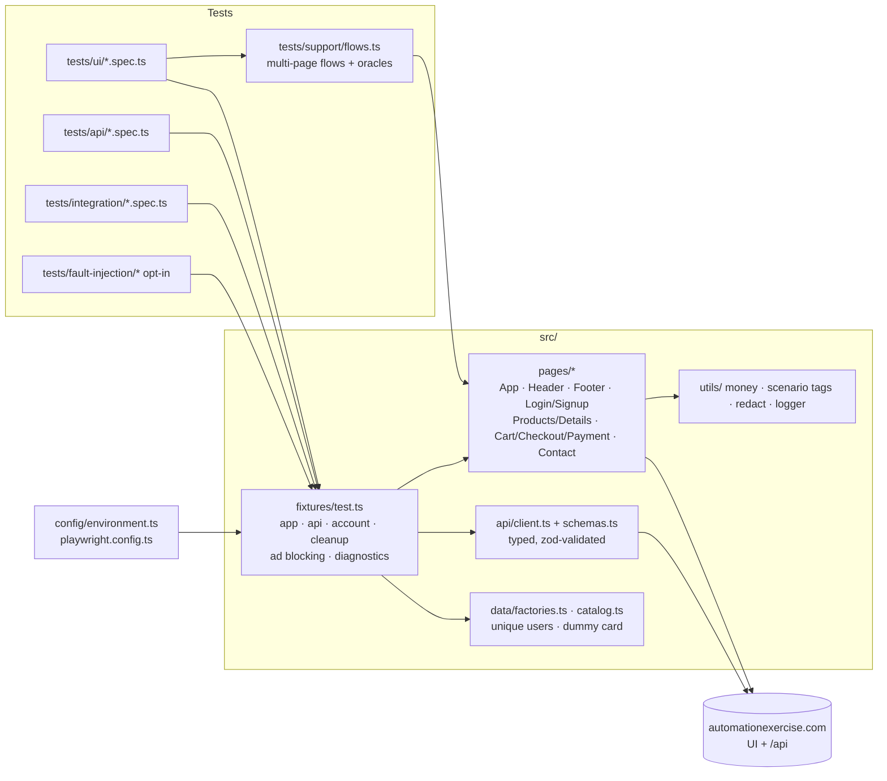
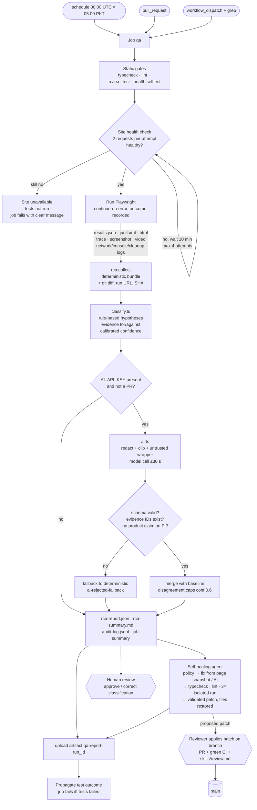

# Architecture

GitHub renders the Mermaid diagrams below. To export images, paste them into mermaid.live.

## 1. Test framework

**Data lifecycle:**
- The `account` fixture creates a user through the API before the test and deletes it in teardown, which runs even when the test fails.
- `cleanup.track()` covers users that a test creates through the UI.
- Both write a redacted `cleanup-log` attachment.

## 2. CI, evidence and RCA pipeline

### Stop conditions and failure safety
- Every diagnostics step uses `if: always()` and `continue-on-error: true`. The original test outcome is re-applied in the last step, so AI or reporting failures can never hide it, and they can never turn a red run green.
- `rca:collect` and `rca:analyze` always exit 0. If there is no report, they write a "no report found" summary instead.
- **Site health check** (`tools/health/probe.ts`) runs before the tests. Each attempt sends two light requests (home page and `/api/productsList`). An attempt is unhealthy on a non-2xx status, the site's "heavy load" page, a wrong API body, a timeout or a response slower than 10 s. Scheduled and manual runs try up to 4 times, 10 min apart (about 30 min of waiting at most); pull requests try once without waiting. If the site never recovers, tests and RCA are skipped and the job fails with "Site unavailable – tests were not run", so the run is never mistaken for a pass or a product failure. The probe table goes to the job summary and `reports/health/`. A crash in the checker itself never blocks testing (tests run). Manual runs can skip the check (`skip_health_check`).
- **Self-healing** (`tools/heal`, `skills/self-healing.md`) runs only when tests failed. It declines anything that is not a stale locator or a test-oracle mistake (product defects, environment, timing, data, injected faults, flaky). A change is proposed only after the type check, lint and 3/3 isolated runs pass; the source file is always restored, and nothing is committed or pushed. Value changes are labelled ASSERTION_CHANGE. Step capped at 20 min and 3 attempts.
- Pull-request runs never receive `AI_API_KEY`, because PR code is untrusted. They get the model-free RCA instead.
- Model calls are bounded at 5 failures per run and 30 s per call by default (repo variable `AI_TIMEOUT_MS`, capped at 60 s). Each call has one attempt, then falls back to the deterministic result. Observed in CI: no credit, a retired endpoint, HTTP 503 overload and a timeout all fell back safely (`docs/ai-evidence/ai-rca-runs.md`).

## 3. Agents and skills
See `agents/orchestrator.md` for the full contract. Each agent is paired with:
- a skill file
- an allowed-tool list
- a human checkpoint

| Interface | Producer → Consumer | Format |
|---|---|---|
| Scenario rows | Test design → Authoring | Markdown table (`docs/traceability.md`) |
| Test results | Execution → RCA | Playwright JSON + attachments |
| Failure bundle | Collector → Classifier / AI | `failure-bundle.json` |
| RCA record | RCA → Reviewer / Repair / Reporting | JSON (`tools/rca/schema/rca-record.schema.json`) + Markdown |
| Audit | RCA → Auditor | JSONL |
| Heal proposal | Self-healing agent → Reviewer | `reports/heal/patches/*.patch` + `heal-summary.md` + `heal-report.json`; reviewer applies on a branch → PR |
